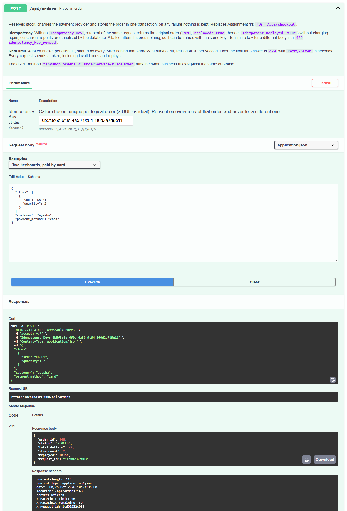
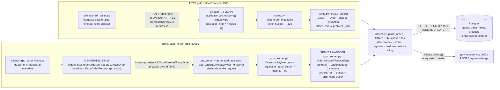
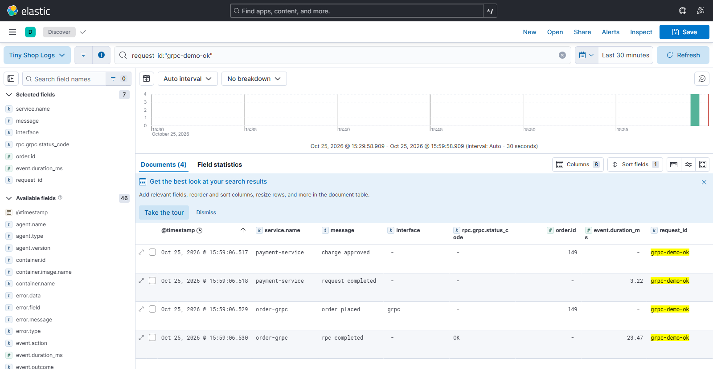
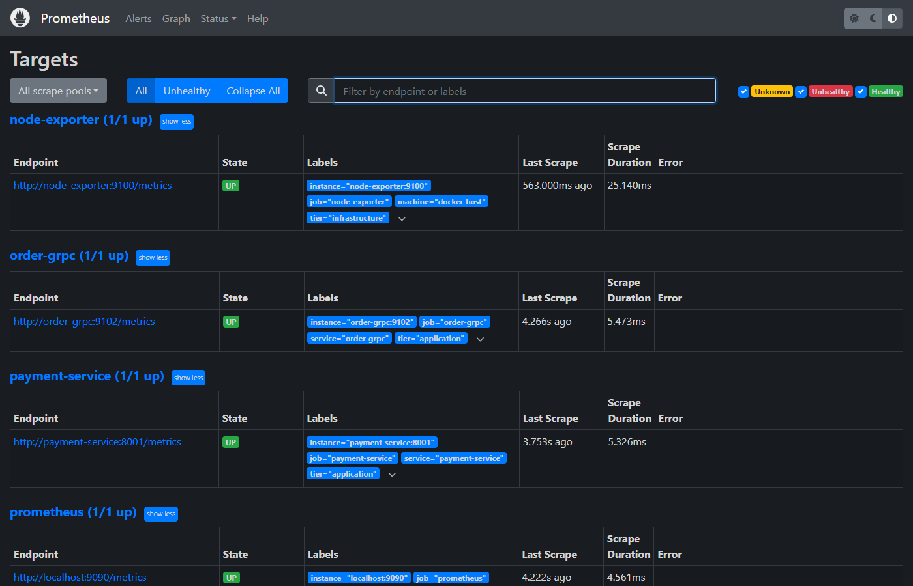
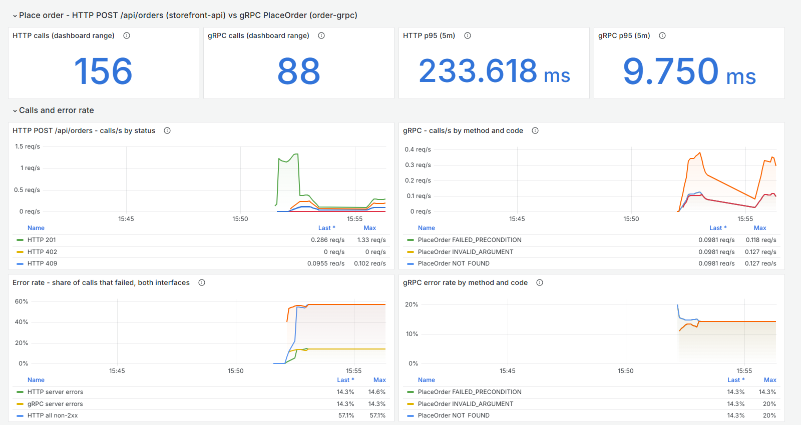
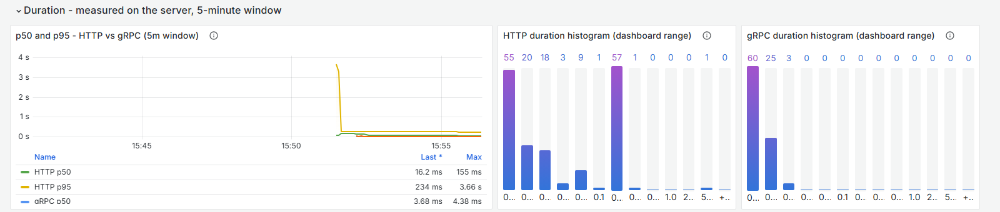
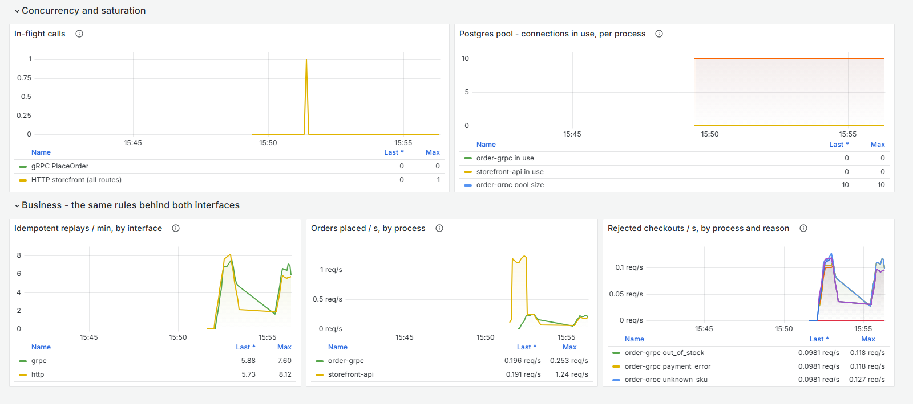

# Assignment 2: HTTP APIs, gRPC, and Metrics — Report

**Enterprise Software Development, Fall 2026** · extends the Assignment 1 project, *Tiny Shop*.
Run and test commands: [README.md §4](README.md#4-assignment-2--run-and-test).
All outputs and screenshots were captured on the full Docker stack on 25 October 2026.

---

# Part A — The HTTP API

## A.1 REST constraints

| Constraint | Meaning | In this API |
| :-- | :-- | :-- |
| **Client–server** | Client and server are separate and can change independently behind a stable interface. | The page, `order_caller.py` and `shopctl` are all clients of one API; only the server touches Postgres and the payment provider. |
| **Stateless** | Each request carries everything needed to handle it; no sessions. | No sessions or cookies; a retry is self-describing via its `Idempotency-Key`. Exception: the rate limiter keeps a per-IP token count. |
| **Cacheable** | Responses say whether they may be reused. | **Not demonstrated** — no `Cache-Control`/`ETag`. `GET /api/products` would be the candidate. |
| **Uniform interface** | Resources named by URLs, standard methods, self-describing messages. | `POST /api/orders` → `201` + `Location: /api/orders/{id}`; status codes carry meaning; errors are `application/problem+json`. |
| **Layered system** | Clients can't tell whether intermediaries sit between them and the server. | Callers never see payment-service or Postgres — only a `502`/`504`. |
| **Code on demand** *(optional)* | Server may send code for the client to run. | Only `GET /` (the page's JavaScript). The JSON API sends none. |

## A.2 OpenAPI

The OpenAPI Specification is a standard, machine-readable (YAML/JSON) description
of an HTTP API: paths, methods, parameters, request/response schemas, status
codes and headers. It acts as the contract between teams, and tools use it to
render interactive docs, generate clients, and test or mock the API.

**Spec:** [`services/storefront-api/openapi.yaml`](services/storefront-api/openapi.yaml)
(OpenAPI 3.1, hand-written). It covers every route, body limits, the
`Idempotency-Key` header, and every success and error status.

**Used to inspect and test:** the service serves it at `/openapi.json`, so
Swagger UI (`localhost:8000/docs`) renders it; below, `POST /api/orders` called
via *Try it out*. `tests/test_assignment2.py` also checks that spec and app
routes match exactly, and validates every real response (15 method/path/status
combinations) against the documented schema.



## A.3 User task: place an order — before and after

| | Before (A1) | Problem | Change | Reason |
| :-- | :-- | :-- | :-- | :-- |
| **Path** | `POST /api/checkout` | Verb in the path; the order has no URL. | `POST /api/orders` → `201` + `Location`; new `GET /api/orders/{id}`. | POST on a collection creates a member. |
| **Retries** | A retry placed a **second** order. | Unsafe to retry after a timeout. | `Idempotency-Key` header (§A.5). | Safe retries. |
| **Unknown SKU** | `404` | `404` means the URL doesn't exist. | `422 unknown_sku` | The body is invalid, not the URL. |
| **Payment timeout** | `502` like any provider error | Two failures indistinguishable. | `504 payment_timeout` | `504` = upstream too slow. |
| **Errors** | Three different shapes | One parser per failure. | One RFC 9457 `problem+json` with `code` and `request_id`. | One parser, stable codes. |
| **Abuse** | Unlimited | One client can exhaust stock and the DB pool. | Token bucket, `429` + `Retry-After` (§A.6). | Protects the service. |

**Other endpoints:**

| Endpoint | Status |
| :-- | :-- |
| `GET /api/products` | Unchanged (errors in the common format). |
| `GET /api/orders?limit=` | Changed: out-of-range `limit` is now `422` instead of silently clamped. |
| `GET /api/orders/{id}` | New: target of `Location`; `404 order_not_found`. |
| `POST /api/orders/{id}/cancel`, `/fulfil` | Changed: idempotent by state (repeat → `200`, no effect); ids bounded to `int4` (`422` instead of a DB `500`). |
| `/admin/*`, `/health`, `/ready`, `/metrics` | Unchanged; operator/ops endpoints out of scope. |

**Callers updated:** the storefront page (new URL, a key per click, shows
`Retry-After`), `shopctl.py`, two Kibana saved searches, and the tests.

## A.4 Error format

Every non-2xx response is an RFC 9457 problem document (`app/errors.py`):

```json
{"type":"urn:tiny-shop:problem:invalid_request","title":"Unprocessable Entity","status":422,
 "detail":"request failed validation","code":"invalid_request","request_id":"report-bad-1",
 "errors":[{"field":"body.items.0.quantity","message":"Input should be greater than 0","type":"greater_than"}]}
```

## A.5 Idempotency

`POST /api/orders` may be retried after a timeout. The caller sends one
`Idempotency-Key` per order and reuses it on every retry. The order row
stores the key (unique index) and a hash of the body. A repeat returns the
original order (`replayed: true`) without taking stock or charging again; the
same key with a different body is `422 idempotency_key_reused`. Concurrent
duplicates are serialised by the unique index, and the insert happens before
the payment call, so the losing request never charges. Failed attempts roll
back completely, so they can be retried. Cancel and fulfil are safe to repeat
because of their state checks, and GETs change nothing.

## A.6 Rate limiting

- **Endpoint:** `POST /api/orders` (`app/ratelimit.py`).
- **Limit:** a token bucket with a burst of **40**, refilled at **20/s**.
- **Who shares it:** every caller with the same client IP. On Docker Desktop
  that's every caller on the host.
- **When calls are allowed again:** as soon as one token refills. `Retry-After`
  rounds up to `1` s.

`python3 scripts/shopctl.py ratelimit` sends 60 requests from 10 threads, then
waits `Retry-After` and sends one more:

```text
  finished in 0.99 s
    HTTP 201 x 55
    HTTP 402 x 2
    HTTP 429 x 3
  first 429 at +0.88 s: Retry-After=1 X-RateLimit-Remaining=0
    {"type": "urn:tiny-shop:problem:rate_limited", "status": 429, "code": "rate_limited",
     "detail": "too many order requests from this client: 40 burst, 20 per second; retry after 1s"}
  waiting Retry-After = 1 s ...
  next request : HTTP 201 X-RateLimit-Remaining=22 order_id=72
```

57 were accepted: the burst of 40 plus about 17 tokens that refilled during
the ~1 s burst. The two `402`s are payment declines; the limiter accepted
those requests.

## A.7 Tests: valid, invalid, repeated

```text
POST /api/orders  Idempotency-Key: report-key-1118629573   {"items":[{"sku":"KB-01","quantity":2}]}
HTTP/1.1 201 Created   location: /api/orders/75
{"order_id":75,"status":"PLACED","total_dollars":98.0,"item_count":2,"replayed":false,...}

same request, same key
HTTP/1.1 201 Created   location: /api/orders/75   idempotent-replayed: true
{"order_id":75,...,"replayed":true,...}

{"items":[{"sku":"KB-01","quantity":0}]}
HTTP/1.1 422   code: invalid_request   field: body.items.0.quantity
```

The automated version is `tests/test_assignment2.py` (128 checks, all pass).
For the repeated request it also asserts exactly one order row, one payment
charge, and stock reduced once.

## A.8 Python caller: timeout, retry, circuit breaker

[`clients/order_caller.py`](clients/order_caller.py) calls `POST /api/orders`
as another service would.

| Setting | Value |
| :-- | :-- |
| Timeout | 1.0 s connect, **2.0 s read** per attempt |
| Retry limit | **3 attempts**; only on timeouts, connection errors, `502`/`503`/`504` |
| Backoff | 0.2 s, then 0.4 s (doubling, cap 2 s), plus 0–50 ms jitter |
| Why retrying POST is safe | the same `Idempotency-Key` on every attempt |
| Breaker | opens after **4 consecutive failures**; stays open **5 s**; then one trial call (success closes it, failure re-opens it) |

`python3 clients/order_caller.py --demo` uses fault injection: payment failures
for server errors, and payment latency for the timeout case. Output, trimmed:

```text
== 1. healthy provider
  [healthy-1] attempt 1/3: 201 in 17 ms -> order 1 PLACED
== 2. one transient failure
  [transient] attempt 1/3: 502 payment_error (transient)
      retrying in 0.22 s with the same Idempotency-Key
      attempt 2/3: 201 in 56 ms -> order 5 PLACED
== 3. lost response (payment takes 2.5 s > 2.0 s timeout)
  [lost-response] attempt 1/3: TIMEOUT after 2013 ms
      attempt 2/3: 201 in 346 ms -> order 6 PLACED  (REPLAYED: no second order)
== 4. provider down
  [outage-1] attempts 1-3: 502, 502, 502 -> gave up after 3 attempts
  [outage-2] attempt 1/3: 502
      breaker: CLOSED -> OPEN (4 consecutive failures; blocking for 5 s)
  [outage-3] BLOCKED by open breaker (no request sent)
== 5. provider repaired
  [still-open] BLOCKED by open breaker
  ... waiting 5.1 s
  [recovered-1] breaker: OPEN -> HALF_OPEN -> CLOSED; 201 -> order 12 PLACED
```

The run shows a success, a retried failure, a timed-out request retried
without a double charge, the breaker blocking calls, and recovery after the
5-second period.

---

# Part B — The gRPC service

## B.1 What was built

The operation is *place an order*, as the unary RPC
`tinyshop.orders.v1.OrderService/PlaceOrder`.

| Piece | Where |
| :-- | :-- |
| Contract | [`proto/orders.proto`](proto/orders.proto): `PlaceOrderRequest` → `PlaceOrderResponse` |
| Generation | `python3 scripts/generate_grpc.py`, i.e. `python -m grpc_tools.protoc -Iapp/grpc_gen=proto --python_out=… --grpc_python_out=… --pyi_out=… proto/orders.proto`. Output is in `app/grpc_gen/`. |
| Handler | `app/grpc_server.py:OrderService.PlaceOrder` |
| Process | new container `order-grpc` (gRPC on `:50051`, metrics on `:9102`) |
| Client | `clients/grpc_order_client.py`: takes items, customer and key as input, sets a deadline (default 2 s), and prints the result or the status, details and `error-code` |

**This is not a wrapper around HTTP.** Both the HTTP route and the gRPC
handler call the same function, `app/orders.py:place_order()`. It holds the
validation, stock check, payment call and idempotency logic, and runs against
the same Postgres database. An order placed over gRPC can be read over HTTP,
and idempotency keys work across both (tested).

## B.2 Success and failure through both versions

| Request | HTTP | gRPC |
| :-- | :-- | :-- |
| 2 × KB-01 | `201 Created` | `OK` |
| unknown SKU | `422 unknown_sku` | `NOT_FOUND` |
| quantity 0 | `422 invalid_request` | `INVALID_ARGUMENT` |
| out of stock / declined | `409` / `402` | `FAILED_PRECONDITION` |
| provider error / DB busy | `502` / `503` | `UNAVAILABLE` |
| provider timeout | `504` | `DEADLINE_EXCEEDED` |
| server bug | `500` | `INTERNAL` |

```text
$ python3 clients/grpc_order_client.py --item KB-01:2 --customer ayesha --request-id grpc-demo-ok
<- OK in 67.9 ms: order_id=73 status=PLACED total=$98.00 items=2 replayed=False (x-request-id=grpc-demo-ok)

$ python3 clients/grpc_order_client.py --item NOPE-01:1
<- NOT_FOUND in 51.6 ms: unknown sku: NOPE-01 (error-code=unknown_sku, x-request-id=grpc-cli-95f560f3)

$ python3 clients/grpc_order_client.py --target localhost:59999 --item KB-01:1 --deadline 1
<- DEADLINE_EXCEEDED in 1006.0 ms: Deadline Exceeded (error-code=-, x-request-id=grpc-cli-0f2f4939)
```

**The statuses compared.** HTTP puts the result in the status line and has a
large vocabulary (`402`, `409`, `422`, `504` …). gRPC always answers HTTP/2
`200`; the result is the `grpc-status` trailer, one of 17 canonical codes.
These are coarser but uniform, and clients use them to decide whether to
retry. `NOT_FOUND` fits an unknown SKU; HTTP uses `422` because `404` would
describe the URL. `FAILED_PRECONDITION` means the request is valid but the
current state rejects it. `UNAVAILABLE` marks a transient failure that is
safe to retry. The `error-code` trailer carries the same codes HTTP uses, so
cases that share a gRPC status can still be told apart.

## B.3 Call paths



## B.4 Logs and trace correlation across gRPC

The A1 correlation ID, `x-request-id`, travels as gRPC **call metadata**.
The interceptor binds it to the call and logs it on `rpc completed`.
`place_order()` logs it and forwards it to payment-service as an HTTP header.
Below, one ID shows lines from both `order-grpc` and `payment-service`. This
was a repeat `grpc-demo-ok` call, order 149, made after the logging fix
described next.



**Fix found on the stack:** this machine's Docker daemon defaults to the
`local` log driver, which Filebeat can't read. `docker-compose.yml` now pins
`json-file` for the application services.

---

# Part C — Metrics

## C.1 Metric gap table (audit of A1)

| A1 metric | Verdict | Action |
| :-- | :-- | :-- |
| `http_requests_total`, `http_request_duration_seconds` | Useful; also shows the `429`s. | Kept as the HTTP side of the panels; the gRPC histogram uses the same buckets. |
| `http_requests_in_flight` | Useful but process-wide. | Kept, shown beside gRPC in-flight. |
| `payment_call_duration_seconds` Summary + `_hist` | Duplicate; the histogram is enough. | Kept for the A1 dashboard. |
| `shop_*` business metrics | Useful. | Now recorded in the shared `place_order()`, so they count both interfaces. |
| `shop_orders_awaiting_fulfilment`, `shop_stock_units` | **Broken by A2:** in-memory counts can't see orders placed by `order-grpc`. | **Fixed:** read from Postgres on each scrape. |
| *missing* | No gRPC metrics. | **Added** `grpc_server_*`. |
| *missing* | DB pool saturation invisible (the root cause of A1's incident). | **Added** `db_pool_connections_in_use` / `_max`. |
| *missing* | Idempotent replays invisible. | **Added** `shop_idempotent_replays_total`. |

## C.2 New metrics

All are in `services/storefront-api/app/telemetry.py`. Labels are bounded,
with no user, order, request or trace IDs.

| Metric | Purpose | Type | Unit | Labels | Code location | Query |
| :-- | :-- | :-- | :-- | :-- | :-- | :-- |
| `grpc_server_handled_total` | calls and errors | Counter | calls | `grpc_service`, `grpc_method`, `grpc_code` | `grpc_server.py` interceptor | `sum by (grpc_method, grpc_code) (rate(grpc_server_handled_total{job="order-grpc"}[1m]))` |
| `grpc_server_handling_seconds` | p50/p95 | Histogram | seconds | `grpc_service`, `grpc_method` | interceptor | `histogram_quantile(0.95, sum by (le) (rate(grpc_server_handling_seconds_bucket{job="order-grpc"}[5m])))` |
| `grpc_server_in_flight` | RPCs in progress | Gauge | calls | `grpc_service`, `grpc_method` | interceptor | `sum(grpc_server_in_flight{job="order-grpc"})` |
| `shop_idempotent_replays_total` | repeats answered | Counter | requests | `interface` | `orders.py` | `sum by (interface) (rate(shop_idempotent_replays_total[1m])) * 60` |
| `db_pool_connections_in_use` / `_max` | pool saturation | Gauge | connections | (`job`) | `db.py` | `db_pool_connections_in_use` vs `db_pool_connections_max` |

**Error rate by method and status:**

```promql
sum by (grpc_method, grpc_code) (rate(grpc_server_handled_total{job="order-grpc",grpc_code!="OK"}[1m]))
  / ignoring(grpc_code) group_left
sum by (grpc_method) (rate(grpc_server_handled_total{job="order-grpc"}[1m]))
```

**Duration is measured at the server** for both interfaces (interceptor or
middleware), so it excludes the network and the client. The buckets are 5,
10, 25, 50, 75, 100, 250, 500, 750 ms, 1, 2.5 and 5 s: dense where healthy
calls land, and finite up to the 5 s payment timeout. p50 and p95 use a
**5-minute window**.

**In-flight rather than message size:** `PlaceOrder` messages are tiny and
nearly constant in size, so a size histogram would be one flat bucket.
In-flight approaching the 10 worker threads shows a backlog behind a slow
dependency, the failure mode seen in A1.

## C.3 Prometheus, Grafana and evidence

Prometheus scrapes `order-grpc:9102` (job `order-grpc`). The dashboard is in
`telemetry/grafana/dashboards/order-interfaces.json`. Traffic comes from
`python3 clients/traffic.py --rounds 12`, which sends the same 7 requests
per round over each interface. The results are repeatable (stock is reset
each round, and exactly one payment failure is injected):

```text
round 12/12: http 201 201 201* 409 422 422 502 | grpc OK OK OK* FAILED_PRECONDITION NOT_FOUND INVALID_ARGUMENT UNAVAILABLE
```





Calls by method and code match the traffic mix. The server-error share is
**14.3 % on both interfaces**: the 1 injected payment failure in each round
of 7.



gRPC `PlaceOrder` has p50 ≈ 3.7 ms and p95 ≈ 9.8 ms. HTTP's p95 in this
window is inflated by the earlier Part A demos (a deliberate 2.5 s payment
delay and the rate-limit burst).



In-flight stays at 0–1 because the traffic is sequential, which gives the
baseline. Replays show ~6/min per interface, and orders arrive from both
processes.

---

# Credits and sources

- RFC 9457 (Problem Details); IETF draft *Idempotency-Key HTTP Header*; Stripe API docs on idempotency.
- gRPC docs, *Status codes*; go-grpc-prometheus / py-grpc-prometheus (metric names only).
- OpenAPI 3.1.0; FastAPI and Swagger UI docs.
- The Assignment 1 stack — see [REPORT.md](REPORT.md#credits-and-sources).
- AI assistance: *declare here as the course academic-integrity policy requires.*
